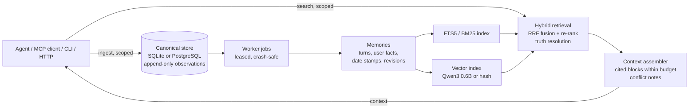

<div align="center">


# Severian

**Long-term memory for AI agents that runs on your own machine, remembers where every fact came from, and keeps
every user's memories apart.**

[](https://python.org)
[](LICENSE)
[](https://github.com/Sahil-SS9/Severian/actions/workflows/ci.yml)
[](#use-it-from)

</div>

Severian gives an agent a memory it can trust. It saves what was said exactly as it was said, derives short searchable
memories from it, and hands the answering model a compact, cited context block for each question. It runs on SQLite
out of the box (PostgreSQL + pgvector when you need it), works fully offline, and plugs into Hermes Agent, any MCP
client, a CLI, an HTTP API or plain Python.

## Results

In October 2026 we ran a head-to-head round against Mem0, Mnemosyne, Hindsight and Honcho: three public
long-term-memory benchmarks, every system under one common rule (same answering model, top 10 memories, Opus
marking), each row a 95% interval.

| System | LoCoMo (199 q) | BEAM 100K (100 q) | LongMemEval (60 q), 5,000 chars | LongMemEval, 1,500 chars |
|---|---|---|---|---|
| **Severian** | **59.8%** (52.8-66.3) | **58.3%** (50.5-66.1) | **66.7%** (55.0-78.3) | 43.3% (31.7-56.7) |
| Severian, features off | 57.8% (50.8-64.8) | 55.7% (48.0-63.7) | 53.3% (40.0-65.0) | 36.7% (25.0-48.3) |
| Mnemosyne | 48.2% (41.2-55.3) | 47.9% (39.8-56.1) | 51.7% (38.3-63.3) | 43.3% (30.0-55.0) |
| Mem0 | 53.3% (46.2-60.3) | 28.4% (21.0-36.0) | 46.7% (33.3-60.0) | **48.3%** (36.7-61.7) |
| Hindsight | 43.2% (36.7-50.3) | 40.8% (33.1-48.7) | not run [e] | not run [e] |
| Honcho | 26.1% (20.1-32.2) | 37.6% (30.1-45.4) | not run [e] | not run [e] |

Severian against the best competitor on the same questions:

- **BEAM: +10.4 points** over Mnemosyne, a clear win.
- **LongMemEval at 5,000 characters: +20.0 points** over Mem0, a clear win.
- **LoCoMo: +6.5 points** over Mem0, ahead.
- LongMemEval at 1,500 characters: level with the best (Mem0 leads overall, but within error).

Where a competitor still leads, by category, and what we think is going on:

| Benchmark / category | Severian | Best other | Note |
|---|---|---|---|
| LoCoMo multi-hop | 26% | Mem0 42% | checked: the evidence is fully present for only 12 of 43, and a quarter of the 10 slots hold no answer |
| LoCoMo open-domain | 46% | Hindsight 46% | tie |
| BEAM abstention | 40% | Mem0 80% | Severian answers when it should say "I don't know"; in 3 of 6 misses the detail came from the assistant's own replies |
| BEAM contradiction resolution | 24% | Honcho 30% | checked: both sides returned in 10 of 10, but nothing says they conflict |
| BEAM knowledge update | 70% | Mnemosyne 85% | checked: old and new value share one timestamp in 2 of 3 misses |
| LongMemEval knowledge update | 50% / 30% at 1,500 | Mnemosyne 70% / Mem0 60% | checked: untrimmed Severian scores 70%; the character limit cuts the evidence |
| Search speed (median) | 63 ms LoCoMo | Honcho 43 ms | fast enough; not fastest |

Category cells hold 10-43 questions each, so single categories are noisy. Both sides of the ledger are published on
purpose: [docs/benchmarks/competitor-round-2026-10.md](docs/benchmarks/competitor-round-2026-10.md) has the method,
footnotes, loss accounting and interval details, and the repository ships the harness itself.

- **As good as perfect recall.** Handed only the turns the datasets label as the answer, the same answering model
  scores 59.8% on LoCoMo and 76.7% on LongMemEval. Severian matches the first and passes the second (81.7% with no
  size limit), because it resolves "yesterday" and "last Friday" to real dates when it saves a turn.
- **Zero leaks, zero stale facts.** On Severian's own adversarial quality gate, a corrected fact never comes back in
  search (0.000 stale-fact rate) and no query ever returns another scope's memory (0.000 leakage).

## Why Severian

- **Nothing is lost, nothing is made up.** Raw observations are append-only and hashed. Every memory and every search
  hit cites the observation it came from, and corrections create a new revision instead of overwriting history, so
  any earlier version can be restored.
- **Scope is the security boundary.** Every read and write names five levels: tenant, profile, collection, agent and
  session. There is no default scope, and another scope's memories are never returned or even hinted at. Agents can
  opt in to reading an explicit list of teammates' scopes.
- **Built for real conversations.** Short facts per turn, real dates for relative times, newer facts that close older
  ones, and a note when two memories disagree, so the agent answers with the current truth.
- **Hybrid search that holds up.** BM25 and vector search fused with reciprocal rank fusion, an optional cross-encoder
  re-ranker, an entity graph for multi-hop lookups, and a context assembler that keeps the most useful items inside a
  character budget.
- **Local-first.** No network call from the engine; cloud derivation needs an explicit per-collection opt-in. Qwen3
  0.6B embeddings run locally or in a shared sidecar; a deterministic hash embedding needs nothing at all.
- **Looks after itself.** Background "dreaming" merges near-duplicates and flags contradictions, curation scores
  salience, and retention policies archive instead of deleting.
- **Operable.** Crash-safe leased worker jobs, dead-letter recovery, export/import, side-by-side vector rebuilds, an
  integrity audit, per-profile fact rollback and an optional Rust acceleration module.
- **Harness-agnostic.** The same engine serves any agent framework through the CLI, the Python SDK, the HTTP API or
  MCP, and runs unchanged on SQLite or PostgreSQL; the Hermes plugin is one adapter on top.

## How it works



- The **canonical store** is the only source of truth. Search indexes are projections that can be rebuilt from it at
  any time.
- **Worker jobs** derive memories and facts in the background, so saving stays fast. A failed job retries and then
  dead-letters; it never silently disappears.
- **Retrieval** runs inside one exact scope, fuses lexical and semantic results, and drops memories a newer fact has
  closed from the current view (they stay in history).

More: [architecture](docs/architecture.md), [memory engine](docs/memory-engine.md), [threat model](docs/threat-model.md).

## Quick start

Requires Python 3.11+ and [uv](https://docs.astral.sh/uv/).

```bash
git clone https://github.com/Sahil-SS9/Severian.git
cd severian
uv sync

# Save an observation in a scope
uv run severian ingest \
  --database data/severian.db --fts data/fts.db --vectors data/vectors.db \
  --tenant acme --profile alice --collection main --agent cli --session ses-1 \
  --content "Alice signed the Acme contract on Friday" \
  --source '{"uri": "note://contract-1"}'

# Search it (--derive processes pending jobs first; production runs `severian work`)
uv run severian search \
  --database data/severian.db --fts data/fts.db --vectors data/vectors.db \
  --tenant acme --profile alice --collection main --agent cli --session ses-1 \
  --query "contract" --derive
```

Or run the Python example, which saves memories for two users, searches one and builds a cited context:

```bash
uv run python examples/quickstart.py
```

## Use it from

| Surface | How |
|---|---|
| **Hermes Agent** | Drop-in memory provider: build with `scripts/build_hermes_plugin.py`, install as `$HERMES_HOME/plugins/severian/`, set `memory.provider: severian`. Tools: search, ingest, correct, forget, shared search, task progress notes. |
| **MCP** | `{"mcpServers": {"severian": {"command": "uv", "args": ["run", "python", "-m", "severian.mcp"]}}}` |
| **Python** | `severian.composition.build_bundle(...)`; see [examples/quickstart.py](examples/quickstart.py) |
| **HTTP** | `uv run severian serve` (dev server); client in `severian.sdk.client` |
| **CLI** | `severian ingest / search / work / export / import / audit / rebuild-vectors / ...` (`--help` lists all) |

## Configuration

Behaviour switches are environment variables, so the same code serves benchmarks, tests and production.

| Setting | Default | What it does |
|---|---|---|
| `SEVERIAN_EMBEDDING` | `hash` | `qwen` (local Qwen3-Embedding-0.6B) or `remote-qwen` (shared sidecar at `SEVERIAN_EMBED_SOCKET`) |
| `SEVERIAN_USER_FACTS` | off (**recommended on**) | Short facts per conversation turn, extracted by a local model in the background |
| `SEVERIAN_DATE_STAMPS` | off (**recommended on**) | Writes real dates next to relative times when saving |
| `SEVERIAN_TRUTH_RESOLUTION` | off (**recommended on**) | Memories a newer fact replaced leave the current view and stay in history |
| `SEVERIAN_RERANK` | off (**recommended**: `cross-encoder/ms-marco-MiniLM-L6-v2`) | Re-ranks the fused candidates |
| `SEVERIAN_OPT_NUMPY` | off (**recommended on**) | Fast exact vector scoring on large scopes |
| `SEVERIAN_CONFLICT_NOTES` | **on** | Adds a short note when two returned memories disagree (`0` turns it off) |
| `SEVERIAN_STORAGE` / `SEVERIAN_DSN` | Hermes store / unset | SQLite directory, or a PostgreSQL DSN |

The recommended settings are the ones benchmarked above. PostgreSQL setup:
[docs/postgresql-backend.md](docs/postgresql-backend.md). Day-to-day running: [docs/operator-runbook.md](docs/operator-runbook.md).

## Roadmap

The published gap list above drives the plan: joining facts across conversations (multi-hop), saying "I don't know"
when nothing fits (abstention), flagging conflicts (done in 0.3.9, now default), and facts that change over time
(knowledge update). Then more competitors (MemMachine, Graphiti/Zep, Letta, Cognee, LangMem, Memobase), a cloud-model
check of the best setup, and extra measures (confident wrong answers vs "I don't know", cost per memory, 10x store
size).

## Contributing and security

See [CONTRIBUTING.md](CONTRIBUTING.md) for the development loop and quality gates, and [SECURITY.md](SECURITY.md) to
report a vulnerability. Release history: [CHANGELOG.md](CHANGELOG.md). All documentation: [docs/](docs/README.md).

## License

MIT. See [LICENSE](LICENSE).
