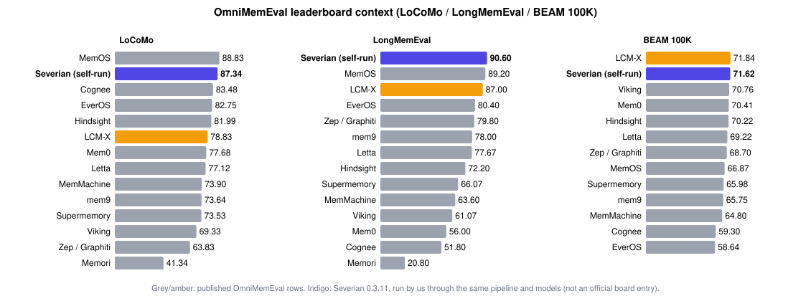

<div align="center">


# Severian

**Long-term memory for AI agents that runs on your own machine, remembers where every fact came from, and keeps
every user's memories apart.**

[](https://python.org)
[](LICENSE)
[](https://github.com/Sahil-SS9/Severian/actions/workflows/ci.yml)
[](#use-it-from)

</div>

Severian gives an agent a memory it can trust. It saves what was said exactly as it was said, derives short searchable
memories from it, and hands the answering model a compact, cited context block for each question. It runs on SQLite
out of the box (PostgreSQL + pgvector when you need it), works fully offline, and plugs into Hermes Agent, any MCP
client, a CLI, an HTTP API or plain Python.

## Results

Severian on the [OmniMemEval](https://github.com/MemTensor/OmniMemEval/blob/main/docs/user_memory/results.md)
long-term-memory leaderboard (October 2026). Every other row is OmniMemEval's own published record, copied verbatim;
Severian's row (†) is our run through the same public harness, answer model (`gpt-4.1-mini`), judge (`gpt-4o-mini`),
prompts and metrics, not an official board entry. 🥇 marks the best score in each column; `-` means not run.

<!-- board:summary -->
| Backend | LoCoMo | LongMemEval | BEAM 100K | BEAM 10M | PersonaMem v2 | HaluMem |
| --- | ---: | ---: | ---: | ---: | ---: | ---: |
| Mem0 | 77.68 | 56.00 | 70.41 | 43.33 | 36.76 | 73.64 |
| Zep / Graphiti | 63.83 | 79.80 | 68.70 | 56.11 | 32.34 | 81.71 |
| Supermemory | 73.53 | 66.07 | 65.98 | 52.49 | 39.64 | 52.61 |
| Viking | 69.33 | 61.07 | 70.76 | 58.14 | 30.80 | 77.39 |
| Cognee | 83.48 | 51.80 | 59.30 | 56.02 | 26.46 | 72.60 |
| Letta | 77.12 | 77.67 | 69.22 | 52.30 | 35.12 | 85.43 |
| Hindsight | 81.99 | 72.20 | 70.22 | **🥇 59.75** | 37.98 | 83.99 |
| Memori | 41.34 | 20.80 | - | - | 33.16 | 49.38 |
| EverOS | 82.75 | 80.40 | 58.64 | 47.73 | 35.94 | **🥇 88.66** |
| MemMachine | 73.90 | 63.60 | 64.80 | 51.90 | 34.14 | 47.02 |
| mem9 | 73.64 | 78.00 | 65.75 | 57.30 | 30.76 | 72.80 |
| MemoryLake | 72.49 | - | - | - | - | - |
| Backboard.io | 22.40 | - | - | - | - | - |
| MemOS | **🥇 88.83** | 89.20 | 66.87 | 56.75 | **🥇 40.58** | 80.91 |
| LCM-X | 78.83 | 87.00 | **🥇 71.84** | - | 33.96 | 81.68 |
| **Severian 0.3.11** † | 87.34 | **🥇 90.60** | 71.62 | - | - | - |
<!-- /board:summary -->



- **1st on LongMemEval, 2nd on LoCoMo, 2nd on BEAM 100K** (0.22 behind LCM-X). The board has no error ranges, and on
  400 questions a gap that small is noise; Severian has not been run on BEAM 10M, PersonaMem v2 or HaluMem yet.
- **We checked the board before building on it.** Re-running LCM-X through the same pipeline gave its published scores
  back within 0.65 points. Compared question by question, Severian is ahead of it on LoCoMo (+7.9, 95% range +6.0 to
  +9.7) and LongMemEval (+4.0, +1.2 to +6.6) and level on BEAM, and a stricter second marker (Claude Opus) agrees.
- **Trade-offs, stated plainly.** Severian hands the answering model more text than most systems and makes model calls
  when it saves memories. Hermes ships it with a cheap 8,000-character context cap, which costs little on LoCoMo but
  about 8 points on BEAM and LongMemEval ([settings](docs/benchmarks/omnimemeval-2026-10.md#severians-own-settings)).
- **We found a marking flaw in BEAM** that rewards made-up answers to "the chat never said" questions. It inflates
  every system's BEAM score, ours included ([details](docs/benchmarks/omnimemeval-2026-10.md#a-marking-flaw-in-beam)).
- **Zero leaks, zero stale facts.** On Severian's own adversarial quality gate, a corrected fact never comes back in
  search (0.000 stale-fact rate) and no query ever returns another scope's memory (0.000 leakage).

Per-benchmark tables for every system (LoCoMo, LongMemEval, BEAM, PersonaMem v2, HaluMem), the LCM-X validation, the
plan and its changes, and the limitations are in
[docs/benchmarks/omnimemeval-2026-10.md](docs/benchmarks/omnimemeval-2026-10.md). Our earlier internal round against
Mem0, Mnemosyne, Hindsight and Honcho (different harness and marker) is in
[docs/benchmarks/competitor-round-2026-10.md](docs/benchmarks/competitor-round-2026-10.md).

## Why Severian

- **Nothing is lost, nothing is made up.** Raw observations are append-only and hashed. Every memory and every search
  hit cites the observation it came from, and corrections create a new revision instead of overwriting history, so
  any earlier version can be restored.
- **Scope is the security boundary.** Every read and write names five levels: tenant, profile, collection, agent and
  session. There is no default scope, and another scope's memories are never returned or even hinted at. Agents can
  opt in to reading an explicit list of teammates' scopes.
- **Built for real conversations.** Short facts per turn, real dates for relative times, newer facts that close older
  ones, and a note when two memories disagree, so the agent answers with the current truth.
- **Hybrid search that holds up.** BM25 and vector search fused with reciprocal rank fusion, an optional cross-encoder
  re-ranker, an entity graph for multi-hop lookups, and a context assembler that keeps the most useful items inside a
  character budget.
- **Local-first.** No network call from the engine; cloud derivation needs an explicit per-collection opt-in. Qwen3
  0.6B embeddings run locally or in a shared sidecar; a deterministic hash embedding needs nothing at all.
- **Looks after itself.** Background "dreaming" merges near-duplicates and flags contradictions, curation scores
  salience, and retention policies archive instead of deleting.
- **Operable.** Crash-safe leased worker jobs, dead-letter recovery, export/import, side-by-side vector rebuilds, an
  integrity audit, per-profile fact rollback and an optional Rust acceleration module.
- **Harness-agnostic.** The same engine serves any agent framework through the CLI, the Python SDK, the HTTP API or
  MCP, and runs unchanged on SQLite or PostgreSQL; the Hermes plugin is one adapter on top.

## How it works

```text
                        ┌──────────────────────────────────────────┐
                        │                SOURCE INPUT              │
                        │  text observation · attachments (multi-  │
                        │  modal metadata: image/audio/video/file) │
                        └──────────────────┬───────────────────────┘
                                           │
                                           ▼
                        ┌──────────────────────────────────────────┐
                        │          IngestionService                │
                        │  normalise · hash raw · source identity  │
                        └──────────────────┬───────────────────────┘
                                           │
                 ┌─────────────────────────┼─────────────────────────┐
                 ▼                         ▼                         ▼
   ┌───────────────────────┐   ┌───────────────────────┐   ┌───────────────────────┐
   │   CANONICAL STORE     │   │   derive job queue    │   │  Entity/Relation       │
   │  (SQLite | PostgreSQL)│──▶│  (leased, crash-safe, │──▶│  Graph (auto-populated │
   │  observations         │   │   idempotent)         │   │  by EntityExtraction)  │
   │  memories             │   └───────────────────────┘   └───────────────────────┘
   │  entities/relations   │
   │  jobs · audit events  │   append-only · scoped · hashed · supersede-aware
   └───────────────────────┘
                 │
                 ▼
   ┌──────────────────────────────────────────────────────────────┐
   │  DerivationService (worker drains derive/episode/dream jobs) │
   │  · policy-gated (cloud_allowed false by default)             │
   │  · deterministic hash OR Qwen 0.6B semantic opt-in          │
   │  · skips superseded observations (P0-5)                      │
   │  · EntityExtractionService upserts entities + typed relations│
   └──────────────────────────────────────────────────────────────┘
                 │
                 ├──────────────► ProjectionCoordinator
                 │                 ├──► FTS5 lexical projection (BM25)
                 │                 └──► vector projection (hash default;
                 │                      Qwen 0.6B semantic opt-in, 384-dim)
                 │
                 ▼
   ┌──────────────────────────────────────────────────────────────┐
   │  RetrievalService (hybrid RRF fusion)                        │
   │  · coverage abstention gate    · salience-weighted ranking   │
   │  · shared-scope read (search_shared, opt-in multi-agent)     │
   │  · temporal query orientation (active head first for present)│
   └───────────────┬──────────────────────────────────────────────┘
                   │
                   ├──────────────► ContextAssembler (bounded, source-cited)
                   │
                   ▼
   ┌──────────────────────────────────────────────────────────────┐
   │  GraphRetrievalService                                       │
   │  · BFS neighborhood over Entity/Relation (both directions)   │
   │  · temporal validity filtering (expired relations excluded)  │
   │  · related_memories by min graph distance                    │
   └──────────────────────────────────────────────────────────────┘

   OFFLINE SELF-REGULATION (dream worker jobs, non-destructive):
   ┌──────────────────────────────────────────────────────────────┐
   │  ConsolidationService  · Jaccard near-dup merge (>= 0.8)     │
   │  CurationService       · salience scoring (recency+usage+    │
   │                          confidence), review markers only    │
   │  RetentionPolicyService· max_age/min_usage/kinds policy,     │
   │                          evaluate + opt-in archive           │
   │  ContradictionScanService · report-only, never auto-resolves │
   └──────────────────────────────────────────────────────────────┘
```


- The **canonical store** is the only source of truth. Search indexes are projections that can be rebuilt from it at
  any time.
- **Worker jobs** derive memories and facts in the background, so saving stays fast. A failed job retries and then
  dead-letters; it never silently disappears.
- **Retrieval** runs inside one exact scope, fuses lexical and semantic results, and drops memories a newer fact has
  closed from the current view (they stay in history).

More: [architecture](docs/architecture.md), [memory engine](docs/memory-engine.md), [threat model](docs/threat-model.md).

## Quick start

Requires Python 3.11+ and [uv](https://docs.astral.sh/uv/).

```bash
git clone https://github.com/Sahil-SS9/Severian.git
cd severian
uv sync

# Save an observation in a scope
uv run severian ingest \
  --database data/severian.db --fts data/fts.db --vectors data/vectors.db \
  --tenant acme --profile alice --collection main --agent cli --session ses-1 \
  --content "Alice signed the Acme contract on Friday" \
  --source '{"uri": "note://contract-1"}'

# Search it (--derive processes pending jobs first; production runs `severian work`)
uv run severian search \
  --database data/severian.db --fts data/fts.db --vectors data/vectors.db \
  --tenant acme --profile alice --collection main --agent cli --session ses-1 \
  --query "contract" --derive
```

Or run the Python example, which saves memories for two users, searches one and builds a cited context:

```bash
uv run python examples/quickstart.py
```

## Use it from

| Surface | How |
|---|---|
| **Hermes Agent** | Drop-in memory provider: build with `scripts/build_hermes_plugin.py`, install as `$HERMES_HOME/plugins/severian/`, set `memory.provider: severian`. Tools: search, ingest, correct, forget, shared search, task progress notes. |
| **MCP** | full seven-tool surface over stdio for Claude Code, Codex, OpenCode and Claude Desktop: [docs/integrations.md](docs/integrations.md). Tools: ingest, search, get, correct, forget, task progress, shared search. |
| **Python** | `severian.composition.build_bundle(...)`; see [examples/quickstart.py](examples/quickstart.py) |
| **HTTP** | `uv run severian serve` (dev server); client in `severian.sdk.client` |
| **CLI** | `severian ingest / search / work / export / import / audit / rebuild-vectors / ...` (`--help` lists all) |

## Configuration

Behaviour switches are environment variables, so the same code serves benchmarks, tests and production.

| Setting | Default | What it does |
|---|---|---|
| `SEVERIAN_EMBEDDING` | `hash` | `qwen` (local Qwen3-Embedding-0.6B) or `remote-qwen` (shared sidecar at `SEVERIAN_EMBED_SOCKET`) |
| `SEVERIAN_USER_FACTS` | off (**recommended on**) | Short facts per conversation turn, extracted by a local model in the background |
| `SEVERIAN_DATE_STAMPS` | off (**recommended on**) | Writes real dates next to relative times when saving |
| `SEVERIAN_TRUTH_RESOLUTION` | off (**recommended on**) | Memories a newer fact replaced leave the current view and stay in history |
| `SEVERIAN_RERANK` | off (**recommended**: `cross-encoder/ms-marco-MiniLM-L6-v2`) | Re-ranks the fused candidates |
| `SEVERIAN_OPT_NUMPY` | off (**recommended on**) | Fast exact vector scoring on large scopes |
| `SEVERIAN_CONFLICT_NOTES` | **on** | Adds a short note when two returned memories disagree (`0` turns it off) |
| `SEVERIAN_FILL_BUDGET` | off | Search over-fetches a bounded pool and the context keeps adding ranked items until its character budget is full, instead of stopping at `limit` |
| `SEVERIAN_COMPACT_CITES` | off | Cites the source observation ids in one bracket and drops the trailing `source:` line: about 45 characters less per item, every citation still resolvable through `severian_get_observation` |
| `SEVERIAN_SUFFICIENCY` | off | Adds one line after the results when no returned memory holds the specific detail the question names |
| `SEVERIAN_STORAGE` / `SEVERIAN_DSN` | Hermes store / unset | SQLite directory, or a PostgreSQL DSN |

The recommended settings are the ones benchmarked above. PostgreSQL setup:
[docs/postgresql-backend.md](docs/postgresql-backend.md). Day-to-day running: [docs/operator-runbook.md](docs/operator-runbook.md).

## Roadmap

Two moves carry the next round: per-person fact sheets to close the multi-hop gap, and a better rule for knowing when
to answer "I don't know". Then a wider field (MemMachine, Graphiti/Zep, Letta, Cognee, LangMem, Memobase), a
cloud-model check of the winning setup, and stricter marks: every in-house run re-marked by Opus, plus cost per
memory, a 10x-size stress test, and a confident-wrong vs "I don't know" measure.

## Contributing and security

See [CONTRIBUTING.md](CONTRIBUTING.md) for the development loop and quality gates, and [SECURITY.md](SECURITY.md) to
report a vulnerability. Release history: [CHANGELOG.md](CHANGELOG.md). All documentation: [docs/](docs/README.md).

## License

MIT. See [LICENSE](LICENSE).
