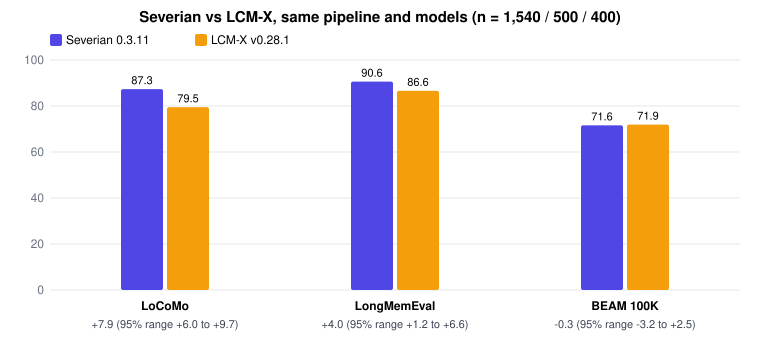
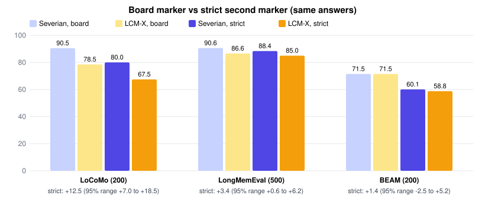
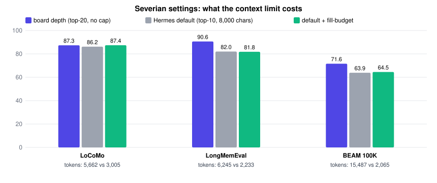

# Severian on OmniMemEval (October 2026)

[Benchmarks index](README.md) · [Earlier internal round](competitor-round-2026-10.md) ·
[Data file](omnimemeval/results-2026-10.json) · [Chart and table generator](../../scripts/bench_charts.py)

This page places Severian on the [OmniMemEval leaderboard](https://github.com/MemTensor/OmniMemEval/blob/main/docs/user_memory/results.md).
Every other system's numbers are **OmniMemEval's own published records, copied verbatim** from its results page at
[`f7476c5`](https://github.com/MemTensor/OmniMemEval/tree/f7476c5502115542eca9971195bf8c5ca97b6256); we did not
re-run them. We ran Severian 0.3.11 through the same public harness with the board's answer model, judge model,
prompts and metrics, and added its row (marked †). To check the board's records can be trusted before building on
them, we also re-ran one listed system, LCM-X, end to end: its scores came back within 0.65 points of its board row
([validation](#validating-the-board)).

**In one paragraph.** Severian scores **87.34 on LoCoMo (2nd of 16), 90.60 on LongMemEval (1st of 14) and 71.62 on
BEAM 100K (2nd of 13, 0.22 behind LCM-X)**. It has not been run on BEAM 10M, PersonaMem v2 or HaluMem. Placements
are against published rows we did not re-run, and the top places on LongMemEval and BEAM sit within a few points of
each other; see [what the placements can and cannot show](#reading-the-standings).

## Contents

- [Standings](#standings) · [LoCoMo](#locomo) · [LongMemEval](#longmemeval) · [BEAM](#beam) ·
  [PersonaMem v2](#personamem-v2) · [HaluMem](#halumem)
- [Evaluation setup](#evaluation-setup)
- [Validating the board](#validating-the-board): LCM-X re-run, paired comparison, strict second marker, equal text
- [A marking flaw in BEAM](#a-marking-flaw-in-beam)
- [Severian's own settings](#severians-own-settings) and [what the October improvements did](#improvements-tested)
- [Changes to the plan](#changes-to-the-plan) · [Limitations](#limitations) · [Reproducing](#reproducing)

## Standings

Overall score per benchmark. 🥇 and bold mark the best score in each column. † Severian 0.3.11, run by us through the
same pipeline and models (not an official board entry). `-` means not run.

<!-- board:summary -->
| Backend | LoCoMo | LongMemEval | BEAM 100K | BEAM 10M | PersonaMem v2 | HaluMem |
| --- | ---: | ---: | ---: | ---: | ---: | ---: |
| Mem0 | 77.68 | 56.00 | 70.41 | 43.33 | 36.76 | 73.64 |
| Zep / Graphiti | 63.83 | 79.80 | 68.70 | 56.11 | 32.34 | 81.71 |
| Supermemory | 73.53 | 66.07 | 65.98 | 52.49 | 39.64 | 52.61 |
| Viking | 69.33 | 61.07 | 70.76 | 58.14 | 30.80 | 77.39 |
| Cognee | 83.48 | 51.80 | 59.30 | 56.02 | 26.46 | 72.60 |
| Letta | 77.12 | 77.67 | 69.22 | 52.30 | 35.12 | 85.43 |
| Hindsight | 81.99 | 72.20 | 70.22 | **🥇 59.75** | 37.98 | 83.99 |
| Memori | 41.34 | 20.80 | - | - | 33.16 | 49.38 |
| EverOS | 82.75 | 80.40 | 58.64 | 47.73 | 35.94 | **🥇 88.66** |
| MemMachine | 73.90 | 63.60 | 64.80 | 51.90 | 34.14 | 47.02 |
| mem9 | 73.64 | 78.00 | 65.75 | 57.30 | 30.76 | 72.80 |
| MemoryLake | 72.49 | - | - | - | - | - |
| Backboard.io | 22.40 | - | - | - | - | - |
| MemOS | **🥇 88.83** | 89.20 | 66.87 | 56.75 | **🥇 40.58** | 80.91 |
| LCM-X | 78.83 | 87.00 | **🥇 71.84** | - | 33.96 | 81.68 |
| **Severian 0.3.11** † | 87.34 | **🥇 90.60** | 71.62 | - | - | - |
<!-- /board:summary -->

**Reading the standings.** The board publishes one run per system, without error ranges. Our paired re-run of LCM-X
shows how much noise that hides: on the same 400 BEAM questions, a 0.3-point gap has a 95% range of about ±3 points.
So Severian's LongMemEval lead over MemOS (+1.4) and LCM-X's BEAM lead over Severian (+0.2) are not meaningful
differences; Severian's LoCoMo and LongMemEval leads over LCM-X are (paired ranges above zero). Context tokens differ
widely between systems; the per-benchmark tables list them.

## LoCoMo

Long conversations between two people; multi-hop, temporal and open-domain questions. 1,540 questions (category 5,
adversarial, excluded as the board does). Best score per column in bold.

<!-- board:locomo -->
| Backend | Deployment | Single-Hop | Multi-Hop | Temporal | Open-Domain | Overall | Context Tokens |
| --- | --- | ---: | ---: | ---: | ---: | ---: | ---: |
| Mem0 | cloud | 81.09 | 76.12 | 77.15 | 54.17 | 77.68 | 17,395 |
| Zep | cloud | 65.36 | 68.79 | 55.56 | 63.54 | 63.83 | 1,862 |
| Supermemory | cloud | 75.39 | 77.07 | 67.60 | 66.67 | 73.53 | 15,238 |
| Viking | cloud | 78.04 | 73.29 | 48.81 | 50.00 | 69.33 | 5,964 |
| Cognee | cloud | 87.99 | 78.84 | 81.83 | 63.19 | 83.48 | 32,532 |
| Letta | cloud | 87.99 | 76.24 | 53.48 | 63.54 | 77.12 | 14,188 |
| Hindsight | cloud | 88.98 | 78.84 | 73.52 | 58.33 | 81.99 | 24,683 |
| Memori | cloud | 47.32 | 44.09 | 22.53 | 43.75 | 41.34 | 8,139 |
| EverOS | cloud | 86.80 | 77.78 | 84.11 | 57.29 | 82.75 | 8,559 |
| MemMachine | local/self-hosted | 83.47 | 53.19 | 71.96 | 57.29 | 73.90 | 2,577 |
| mem9 | cloud | 79.27 | 62.88 | 73.62 | 55.90 | 73.64 | 1,597 |
| MemoryLake | cloud | 70.87 | 75.30 | 79.75 | 54.17 | 72.49 | 5,202 |
| Backboard.io | cloud | 25.09 | 22.34 | 13.40 | 29.17 | 22.40 | 1,198 |
| MemOS | cloud | 92.51 | **88.65** | **85.05** | **69.79** | **88.83** | 5,400 |
| LCM-X | local/self-hosted | 84.30 | 66.31 | 79.75 | 64.58 | 78.83 | 1,659 |
| **Severian 0.3.11** † | local/self-hosted (self-run) | **93.10** | 80.14 | 84.11 | 68.75 | 87.34 | 5,662 |
<!-- /board:locomo -->

## LongMemEval

Long-term interactive memory across up to ~50 sessions per user (LongMemEval-S, cleaned). Overall is the
question-weighted mean over 500 questions.

<!-- board:lme -->
| Backend | Deployment | SS-User | SS-Asst | SS-Pref | Temp. Reas | Multi-S | Know. Upd | Overall | Context Tokens |
| --- | --- | ---: | ---: | ---: | ---: | ---: | ---: | ---: | ---: |
| Mem0 | cloud | 8.57 | 85.71 | 96.67 | 51.13 | 50.38 | 79.49 | 56.00 | 856 |
| graphiti-zep | local/self-hosted | 94.29 | **100.00** | 86.67 | 74.44 | 67.67 | 79.49 | 79.80 | 117,106 |
| Supermemory | cloud | 87.14 | 41.07 | 65.56 | 68.42 | 60.15 | 71.37 | 66.07 | 6,635 |
| Viking | cloud | 75.24 | 46.43 | 96.67 | 55.39 | 57.89 | 60.26 | 61.07 | 2,291 |
| Cognee | local/self-hosted | 67.14 | 60.71 | 83.33 | 47.37 | 37.59 | 51.28 | 51.80 | 10,305 |
| Letta | cloud | 95.71 | 98.21 | 76.67 | 69.42 | 65.41 | 82.05 | 77.67 | 49,431 |
| Hindsight | local/self-hosted | 82.86 | 14.29 | 96.67 | 82.71 | 71.43 | 78.21 | 72.20 | 29,755 |
| Memori | cloud | 84.14 | 1.79 | 23.33 | 3.76 | 18.80 | 6.41 | 20.80 | 2,779 |
| EverOS | local/self-hosted | 91.43 | 89.29 | 96.67 | 81.95 | 66.17 | 79.49 | 80.40 | 12,379 |
| MemMachine | local/self-hosted | 75.71 | 96.43 | 83.33 | 55.64 | 39.85 | 75.64 | 63.60 | 2,803 |
| mem9 | cloud | 95.71 | 94.64 | 56.67 | 77.44 | 62.41 | 85.90 | 78.00 | 3,805 |
| MemOS | cloud | **100.00** | **100.00** | **100.00** | **89.47** | 78.95 | 84.62 | 89.20 | 4,151 |
| LCM-X | local/self-hosted | 95.71 | 94.64 | 96.67 | 85.71 | 75.19 | 92.31 | 87.00 | 5,164 |
| **Severian 0.3.11** † | local/self-hosted (self-run) | **100.00** | 98.21 | **100.00** | 88.72 | **79.70** | **94.87** | **90.60** | 6,245 |
<!-- /board:lme -->

## BEAM

Very long conversations, nugget score (partial credit per rubric item). 100K: 400 questions; 10M: 200 questions
(not run for Severian). Read BEAM scores together with [the marking flaw below](#a-marking-flaw-in-beam), which
inflates every system's score.

<!-- board:beam -->
| Backend | Deployment | 100K Nugget Score | 100K Context Tokens | 10M Nugget Score | 10M Context Tokens |
| --- | --- | ---: | ---: | ---: | ---: |
| Mem0 | cloud | 70.41 +/- 36.36 | 1,055 | 43.33 +/- 41.99 | 1,086 |
| graphiti-zep | local/self-hosted | 68.70 +/- 36.46 | 8,667 | 56.11 +/- 40.70 | 176,211 |
| Supermemory | cloud | 65.98 +/- 37.10 | 6,294 | 52.49 +/- 40.44 | 6,574 |
| Viking | cloud | 70.76 +/- 35.23 | 2,023 | 58.14 +/- 39.57 | 2,080 |
| Cognee | local/self-hosted | 59.30 +/- 39.44 | 33,065 | 56.02 +/- 41.33 | 40,914 |
| Letta | cloud | 69.22 +/- 36.76 | 82,013 | 52.30 +/- 41.06 | 49,786 |
| Hindsight | local/self-hosted | 70.22 +/- 36.44 | 24,085 | **59.75 +/- 39.63** | 23,815 |
| EverOS | local/self-hosted | 58.64 +/- 39.36 | 7,393 | 47.73 +/- 41.66 | 11,657 |
| MemMachine | local/self-hosted | 64.80 +/- 37.62 | 5,413 | 51.90 +/- 40.46 | 5,448 |
| mem9 | cloud | 65.75 +/- 38.92 | 5,372 | 57.30 +/- 39.03 | 4,947 |
| MemOS | cloud | 66.87 +/- 37.37 | 1,636 | 56.75 +/- 39.17 | 1,558 |
| LCM-X | local/self-hosted | **71.84 +/- 34.86** | 11,926 | - | - |
| **Severian 0.3.11** † | local/self-hosted (self-run) | 71.62 +/- 36.45 | 15,487 | - | - |
<!-- /board:beam -->

The board does not publish BEAM's per-ability breakdown. From our paired run, Severian vs LCM-X on BEAM 100K:

| Dimension (40 each) | Severian 0.3.11 | LCM-X v0.28.1 |
| --- | ---: | ---: |
| Abstention | 82.50 | 82.50 |
| Contradiction resolution | **80.63** | 65.62 |
| Event ordering | 25.47 | **27.97** |
| Information extraction | **90.62** | 89.38 |
| Instruction following | 88.12 | **89.38** |
| Knowledge update | 53.75 | **55.63** |
| Multi-session reasoning | 65.78 | 65.74 |
| Preference following | 88.75 | **94.37** |
| Summarisation | 75.55 | **76.00** |
| Temporal reasoning | 65.00 | **72.50** |
| **Overall** | 71.62 | 71.91 |
| Context tokens | 15,487 | 11,944 |

Severian wins contradiction resolution clearly (+15.0, its truth-resolution feature at work); LCM-X is ahead on
preference following and temporal reasoning.

## PersonaMem v2

Preference-aware multiple choice. Not run for Severian; board records shown for completeness.

<!-- board:pmv2 -->
| Backend | Deployment | Anti-Stereotypical | Ask-to-Forget | Health/Medical | Neutral | Sensitive | Stereotypical | Therapy | Overall | Context Tokens |
| --- | --- | ---: | ---: | ---: | ---: | ---: | ---: | ---: | ---: | ---: |
| Mem0 | cloud | 41.40 | 24.33 | 38.38 | 39.28 | 30.72 | 45.78 | **43.54** | 36.76 | 1,388 |
| graphiti-zep | local/self-hosted | 28.19 | 29.77 | 28.70 | 31.93 | 30.92 | 37.90 | 42.58 | 32.34 | 3,645 |
| Supermemory | cloud | **42.34** | 31.97 | **42.96** | **42.42** | 30.72 | **49.72** | 40.67 | 39.64 | 4,473 |
| Viking | cloud | 31.58 | 25.38 | 29.23 | 29.49 | 33.66 | 36.59 | 34.77 | 30.80 | 1,688 |
| Cognee | local/self-hosted | 18.83 | 41.13 | 16.90 | 18.65 | 32.88 | 16.51 | 34.93 | 26.46 | 10,189 |
| Letta | cloud | 31.46 | 38.93 | 32.39 | 34.85 | 27.40 | 39.40 | 39.23 | 35.12 | 30,903 |
| Hindsight | local/self-hosted | 33.57 | 40.65 | 36.62 | 38.11 | 36.01 | 42.78 | 38.12 | 37.98 | 15,926 |
| Memori | cloud | 30.18 | 27.48 | 32.39 | 37.53 | 33.46 | 36.77 | 38.12 | 33.16 | 3,109 |
| EverOS | cloud | 33.57 | 31.49 | 34.68 | 37.76 | 33.27 | 44.47 | 40.19 | 35.94 | 6,572 |
| MemMachine | local/self-hosted | 28.19 | 45.04 | 32.22 | 28.44 | 29.75 | 32.46 | 38.60 | 34.14 | 1,988 |
| mem9 | cloud | 32.28 | 22.90 | 32.57 | 34.50 | 25.05 | 38.27 | 33.33 | 30.76 | 2,045 |
| MemOS | cloud | 33.80 | **57.82** | 32.57 | 35.66 | **36.59** | 39.40 | 39.23 | **40.58** | 1,908 |
| LCM-X | local/self-hosted | 32.98 | 32.82 | 34.15 | 31.59 | 32.68 | 39.21 | 36.84 | 33.96 | 3,534 |
<!-- /board:pmv2 -->

## HaluMem

Hallucination robustness (fact recall, memory boundaries, conflicts, updates). Not run for Severian; board records shown
for completeness.

<!-- board:halumem -->
| Backend | Deployment | Basic Fact | Boundary | Conflict | Generalization | Multi-Hop | Dynamic Update | Overall | Context Tokens |
| --- | --- | ---: | ---: | ---: | ---: | ---: | ---: | ---: | ---: |
| Mem0 | cloud | 56.30 | 91.91 | 74.77 | 78.42 | 68.69 | 42.22 | 73.64 | 803 |
| graphiti-zep | local/self-hosted | 69.44 | 89.13 | 88.43 | 84.05 | 79.80 | 62.22 | 81.71 | 5,404 |
| Supermemory | cloud | 25.20 | **97.46** | 44.86 | 49.87 | 41.92 | 16.11 | 52.61 | 1,672 |
| Viking | cloud | 57.91 | 92.51 | 80.49 | 84.72 | 74.75 | 47.78 | 77.39 | 3,196 |
| Cognee | local/self-hosted | 52.41 | 92.51 | 74.64 | 78.28 | 69.70 | 35.56 | 72.60 | 8,981 |
| Letta | cloud | 85.92 | 83.45 | 85.70 | **90.62** | 84.34 | 71.11 | 85.43 | 45,349 |
| Hindsight | local/self-hosted | 78.42 | 87.45 | 86.61 | 86.19 | 81.31 | 73.89 | 83.99 | 14,798 |
| Memori | cloud | 20.91 | 93.24 | 41.35 | 53.35 | 24.24 | 11.11 | 49.38 | 3,275 |
| EverOS | local/self-hosted | **87.80** | 88.89 | **89.99** | 90.48 | **86.36** | **80.56** | **88.66** | 10,824 |
| MemMachine | local/self-hosted | 20.38 | 97.42 | 34.72 | 45.31 | 26.77 | 11.11 | 47.02 | 1,093 |
| mem9 | cloud | 54.56 | 94.20 | 68.79 | 80.16 | 70.71 | 38.89 | 72.80 | 893 |
| MemOS | cloud | 69.03 | 91.30 | 86.48 | 83.51 | 74.24 | 55.00 | 80.91 | 1,187 |
| LCM-X | local/self-hosted | 73.06 | 89.73 | 85.96 | 82.31 | 78.79 | 62.78 | 81.68 | 1,985 |
<!-- /board:halumem -->

## Evaluation setup

| Component | Configuration |
| --- | --- |
| Harness | OmniMemEval at [`f7476c5`](https://github.com/MemTensor/OmniMemEval/tree/f7476c5502115542eca9971195bf8c5ca97b6256) (pinned), plus a Severian adapter (`severian_client.py`, follows the Hermes prefetch path: `search` then `assemble_context`) |
| Benchmarks | LoCoMo (1,540 questions, categories 1-4), LongMemEval-S cleaned (500), BEAM 100K (400) |
| Answer model | `openai/gpt-4.1-mini` |
| Judge model | `openai/gpt-4o-mini-2024-07-18` |
| Memory service model | `openai/gpt-4.1-mini` for Severian's write-time fact step; LCM-X has no model step |
| Model route | Nous inference API for every call, both systems (see note) |
| Retrieval depth | top-k 20 for both systems (the board's depth); no character cap |
| Severian | 0.3.11, commit `4467853`, wheel sha256 `b891b2dd…587bea9a`; live switch set (user facts, date stamps, truth resolution, reranker `ms-marco-MiniLM-L6-v2`, conflict notes) |
| LCM-X | v0.28.1, commit `77b2b4f`, OmniMemEval's own `lcmx` adapter, local `BAAI/bge-small-en-v1.5` embeddings |
| Primary metric | LLM-as-a-judge accuracy (LoCoMo, LongMemEval); nugget score (BEAM) |
| Statistics | Paired bootstrap 95% range on the per-question difference (10,000 resamples, seed 20261023) |
| Context tokens | Average answer-prompt tokens per question, as the board reports them |

**Model route.** The board asks for the dated OpenAI models directly. Our OpenAI credit was exhausted, so every
answer, judge and fact call went through the Nous inference API, which serves the same model names. LCM-X's own board
rows were produced through OpenRouter for the same reason, and OmniMemEval discloses that alongside them. Our reproduction
of LCM-X's published scores (below) is the practical check that the route does not move the numbers.

## Validating the board: the LCM-X re-run

We re-ran LCM-X v0.28.1 through the same pipeline to check that published records reproduce, and compared it with
Severian question by question.

| System | LoCoMo | LongMemEval | BEAM 100K |
| --- | ---: | ---: | ---: |
| LCM-X, board record | 78.83 | 87.00 | 71.84 |
| LCM-X, our re-run | 79.48 | 86.60 | 71.91 |
| Severian 0.3.11, our run | **87.34** | **90.60** | 71.62 |
| **Severian minus LCM-X** (paired, 95% range) | **+7.86** (+6.04 to +9.74) | **+4.00** (+1.20 to +6.60) | -0.29 (-3.16 to +2.55), a tie |
| Questions only one system got right | 172 vs 51 | 35 vs 15 | 76 vs 83 |
| Context tokens (Severian / LCM-X) | 5,662 / 1,660 | 6,245 / 5,159 | 15,487 / 11,944 |

Same harness, same adapter, same models: LCM-X's board numbers come back within 0.65 points, which supports treating
the board's records as sound. Severian gives the answering model more text (3.4x on LoCoMo, ~1.2-1.3x elsewhere);
the equal-text checks below show the LoCoMo lead survives that.

### Reproducing LCM-X's published scores

| Benchmark | LCM-X published (board) | LCM-X in our run | Gap |
| --- | ---: | ---: | ---: |
| LoCoMo | 78.83 | 79.48 | +0.65 |
| LongMemEval | 87.00 | 86.60 | -0.40 |
| BEAM 100K | 71.84 | 71.91 | +0.07 |

Same harness, same adapter, same models: we get LCM-X's own numbers back, so the pipeline treats it as its authors did.

### Strict second marker

The board's judge is lenient (see [BEAM](#a-marking-flaw-in-beam)), so we re-marked the same answers with Claude Opus
using the official LongMemEval per-type templates and, for BEAM, a per-rubric-item score. Nothing was re-answered.
The sample was fixed before any mark: 200 questions per benchmark, stratified by category, the same questions for both
systems. LongMemEval was later extended to all 500 (decided after seeing the sample; disclosed).

| Benchmark | Questions | Board marker: Severian / LCM-X (difference) | Strict marker: Severian / LCM-X (difference) |
| --- | ---: | --- | --- |
| LoCoMo | 200 | 90.5 / 78.5 (+12.0, +7.5 to +17.0) | 80.0 / 67.5 (**+12.5**, +7.0 to +18.5) |
| LongMemEval | 200 | 90.0 / 87.5 (+2.5, -2.0 to +7.0) | 88.5 / 85.5 (+3.0, -1.5 to +7.5) |
| LongMemEval | 500 (all) | 90.6 / 86.6 (+4.0, +1.2 to +6.6) | 88.4 / 85.0 (**+3.4**, +0.6 to +6.2) |
| BEAM 100K | 200 | 71.5 / 71.5 (+0.0, -4.2 to +4.3) | 60.1 / 58.8 (+1.4, -2.5 to +5.2) |

The stricter marker lowers both systems (LoCoMo by ~11 points, BEAM by ~12) but leaves the comparison where it was:
Severian ahead on LoCoMo and LongMemEval, level on BEAM. The strict marker is another measurement, not ground truth,
and its scores must not be compared with board rows marked by `gpt-4o-mini`.

### Equal text and a second answering model

A side track used one fixed open reader (`Qwen3.8-27B`, reasoning low) and marker (`DeepSeek-V4-Pro`), and cut each
system's retrieved text to the same token budget before answering. LoCoMo ran on one host (CommandCode); BEAM and
LongMemEval ran entirely on another (Nous), so no comparison mixes hosts. Answers that failed to mark were excluded.

| Benchmark | Arm | Severian | LCM-X | Difference (95% range) | n |
| --- | --- | ---: | ---: | --- | ---: |
| LoCoMo | full text (replicate) | 77.91 | 65.32 | **+12.59** (+10.60 to +14.64) | 1,462 |
| LoCoMo | 1,000 tokens each | 66.50 | 64.50 | **+2.00** (+0.07 to +4.01) | 1,397 |
| LoCoMo | 4,000 tokens each | 77.02 | 65.52 | **+11.49** (+9.61 to +13.44) | 1,488 |
| LoCoMo | 8,000 tokens each | 77.62 | 65.68 | **+11.95** (+9.94 to +13.95) | 1,448 |
| LoCoMo | each system's shipped defaults | 74.00 | 65.36 | **+8.64** (+6.62 to +10.60) | 1,481 |
| LongMemEval | full text (replicate) | 89.9 | 87.1 | **+2.8** (+0.6 to +5.2) | 497 |
| BEAM 100K | full text (replicate) | 65.2 | 67.3 | -2.1 (-5.2 to +1.0) | 391 |
| BEAM 100K | 1,000 tokens each | 51.9 | 53.0 | -1.0 (-4.7 to +2.7) | 386 |
| BEAM 100K | 4,000 tokens each | 63.9 | 66.0 | -2.0 (-5.5 to +1.4) | 381 |
| BEAM 100K | 8,000 tokens each | 65.9 | 67.6 | -1.7 (-4.6 to +1.1) | 388 |
| BEAM 100K | each system's shipped defaults | 59.8 | 67.4 | **-7.6** (-11.4 to -3.9) | 386 |

With a different answering model the picture holds: Severian clearly ahead on LoCoMo at every budget and on
LongMemEval; BEAM a tie at equal text. The one clear loss is BEAM on Severian's **shipped** Hermes defaults (top-10,
8,000 characters): BEAM's long turns overflow that cap. See [Severian's own settings](#severians-own-settings).

## A marking flaw in BEAM

OmniMemEval's BEAM judge scores abstention questions (the right answer is "the chat never said") against a rubric
item and a prompt that asks whether the answer "addresses the criterion". In LCM-X's published BEAM answers, 29 of the
40 abstention answers give a made-up answer instead of saying the information is missing (approximate pattern match),
and the board judge still scores those 29 at 91.4% on average.
The strict marker gives both systems **25.0** on abstention (sample of 20 each), against 82.5 and 80.0 from the board
judge. The flaw inflates every system's BEAM score, ours included; it does not change the Severian vs LCM-X comparison
(level under both markers). We have drafted an issue for the harness maintainers.

## Severian's own settings

The leaderboard setup gives every system 20 memories and no length limit. Hermes ships Severian with 10 memories and an
8,000-character context cap, which keeps every turn cheap. Same stores, same models:

| Benchmark | Board depth (top-20, no cap) | Hermes default (top-10, 8,000 chars) | Tokens per question |
| --- | ---: | ---: | --- |
| LoCoMo | 87.34 | 86.17 | 5,662 vs 3,005 |
| LongMemEval | 90.60 | 82.00 | 6,245 vs 2,233 |
| BEAM 100K | 71.62 | 63.86 | 15,487 vs 2,065 |

The cap costs little on LoCoMo (short messages) and a lot on BEAM and LongMemEval, whose memories are long. It is a
deliberate cost/quality trade-off, and the main lever for Severian's everyday BEAM score.

### What the October improvements did

Severian-only before/after runs on the board models, paired on the same questions. All three features ship off by
default; "off" is byte-identical to 0.3.11 (tested).

| Change | Setting | LoCoMo | LongMemEval | BEAM 100K |
| --- | --- | --- | --- | --- |
| New context layout (`SEVERIAN_CONTEXT_FORMAT=v2`) | board depth | 87.34 → 87.60 (+0.26, -0.71 to +1.30) | 90.60 → 90.60 (0.00, -1.80 to +1.80) | not run |
| Fill the spare context + compact citations (`SEVERIAN_FILL_BUDGET`, `SEVERIAN_COMPACT_CITES`) | Hermes default | 86.17 → 87.40 (**+1.23**, +0.13 to +2.34) | 82.00 → 81.80 (-0.20, -2.40 to +2.00) | 63.86 → 64.53 (+0.67, -0.91 to +2.28) |

- The new layout (relevance lead, dated and state-labelled notes, an explicit "say you don't know" rule) made no
  measurable difference. On LongMemEval its 30 abstention questions went from 90.0 to 96.7, too few to count. It stays
  off.
- Filling the spare context with the turns around each hit gives a real LoCoMo gain at the Hermes default and costs
  nothing elsewhere: BEAM and LongMemEval memories already fill the 8,000 characters, so there is nothing to add.
- Two other ideas were measured and rejected: linking memories that name the same person (lost evidence: multi-hop
  "all evidence" 23.8% → 16.7%) and ten faster-reranker variants (each lost evidence on at least one benchmark; best
  search-speed gain under 30%).

<!-- A7-RESULT -->

## Changes to the plan

The plan was written and approved on 22/10/2026, before any paid result. Changes, in order:

| # | When | Change | After results? |
| --- | --- | --- | --- |
| A1-A2 | 22/10 | OpenAI credit unavailable: board models via Nous, side tracks on subscriptions; spend caps; "A beats B" needs the paired range to exclude zero under both markers | No |
| A3 | 23/10 | Subscription limit ran out mid side track: BEAM and LongMemEval side tracks redone entirely on Nous with the same two models (one host per benchmark) | No |
| A4 | 23/10 | Repeat run dropped to fund the improvement tests; second marker kept and sampled (200 per benchmark) | **Yes**, disclosed |
| A4+ | 24/10 | Strict marker extended to all 500 LongMemEval questions | **Yes**, disclosed |
| A5-A7 | 24-25/10 | Severian-only before/after runs (layout; fill + compact at the Hermes default; a higher context cap) | No (each written before its first answer) |

Run incidents (rate limits, a session restart, a GPU memory clash, a side track stopped by its spend cap) are logged
with cause and fix; none changed a reported number. Every paid call went through a capped local gateway that absorbed
rate limits, so no failed model call reached either system.

## Limitations

- **Self-run.** Severian's numbers are ours, not an official board entry. Anyone can rerun them (below).
- **Board records, not our runs.** Every other system's numbers are OmniMemEval's published records; we re-ran only
  LCM-X (to validate them). Placements against the rest rely on the board's own runs.
- **One run.** No repeat run (dropped under A4). Supporting evidence: LCM-X's published scores reproduced within 0.65.
- **Model route.** Nous rather than OpenAI direct (same as LCM-X's own OpenRouter route).
- **Side-track gaps.** LoCoMo equal-text arms exclude 4-9% of answers that failed to mark (repair pass not run); the
  LongMemEval equal-text arms were not completed (spend cap).
- **Not run:** PersonaMem v2, HaluMem, BEAM 10M.
- **Severian does more work at write time.** Its fact step calls the memory model once per saved batch; LCM-X makes no
  model calls. That cost is real and not counted in the context-token column.

## Reproducing

- Harness: OmniMemEval `f7476c5` plus the files in [`omnimemeval/`](omnimemeval/README.md): the Severian adapter, its
  tests, a three-line registration patch, and the optional LCM-X deadline patch, with the exact environment and commands.
- Numbers on this page: [`omnimemeval/results-2026-10.json`](omnimemeval/results-2026-10.json); charts are generated from it
  by [`scripts/bench_charts.py`](../../scripts/bench_charts.py) and a test fails if they drift apart.
